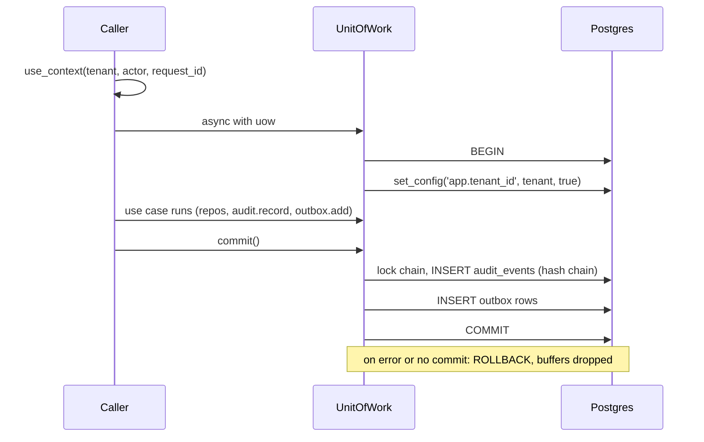

# Data architecture

How services store data: Postgres roles, row-level security, the platform tables and the unit of
work. All of it lives in `libs/py/sb_db`. Rules: A13 (tenancy), A14 (audit), A11 (outbox),
C10 (typed, bounded SQL).

## One database per service, four roles

Each service has its own database. `sb_db.database.ensure_database` creates it on the first
migrate, so compose never changes per service. The roles are created once by
`compose/postgres/init/01-roles.sh`.

| Role | Attributes | Used for |
|---|---|---|
| `sb_admin` | superuser | Compose bootstrap only. Services never connect as it |
| `sb_migrator` | `LOGIN CREATEDB BYPASSRLS` | Runs migrations and backfills. Owns the service databases. Sees every tenant's rows |
| `sb_app` | `NOSUPERUSER NOBYPASSRLS` | Runtime. Every query is subject to RLS |
| `sb_readonly` | `NOSUPERUSER NOBYPASSRLS` | Read-only access (reporting, debugging). Holds no grants by default: each service's migrations `GRANT SELECT` on what it may read |

Because `sb_migrator` bypasses RLS, tests that prove tenant isolation must run as `sb_app`.
The `sb_testing` Postgres container creates the same three roles with the same attributes (a
unit test keeps it in step with `01-roles.sh`) and exposes `postgres_url` (superuser),
`postgres_migrator_url` and `postgres_app_url`. Like compose, it grants `sb_app` nothing beyond
the default `USAGE` on `public`: tests grant table privileges explicitly, as a migration would.
Connections have explicit connect and command timeouts (`sb_db.engine`, C6). Migrations get a
longer command timeout, since index builds can outlast the runtime limit. The engine sets
`hide_parameters=True`, so bound values never appear in SQLAlchemy logs or error messages (C9).

## Row-level security (A13)

The tenant comes only from the request context (`sb_kernel.context`), never from a parameter.
Every tenant-scoped table has `tenant_id uuid NOT NULL`, and the migration applies
`sb_db.rls.enable_rls_sql(table)`:

- `ENABLE ROW LEVEL SECURITY` and `FORCE ROW LEVEL SECURITY`. FORCE makes the table owner obey the
  policy too.
- One policy, `<table>_tenant_isolation`, for reads and writes:
  `tenant_id = NULLIF(current_setting('app.tenant_id', true), '')::uuid`, both as `USING` and
  `WITH CHECK`. With no tenant set, the setting is empty, the expression is NULL, and no rows match.

The unit of work sets the tenant with `SELECT set_config('app.tenant_id', :tenant, true)`. The
`true` makes it transaction-local, so it cannot leak to the next user of a pooled connection.

The DDL helpers validate identifiers (lowercase `[schema.]table`) and raise `ValueError` on
anything else, since they build SQL by string. They also reject a table whose derived policy,
trigger or function name would exceed Postgres's 63-byte identifier limit (it would be silently
truncated, and two tables could collide).

### Which platform tables are RLS-scoped

`install_platform_tables` only creates the tables. The state below is **required**, and each
service's initial migration applies it with `sb_db.rls.platform_table_ddl()`, so services ship the
same DDL the library's tests run against. The migration's `downgrade()` applies
`sb_db.rls.platform_table_ddl_downgrade()` before dropping the tables. It drops the policies,
triggers and function and disables RLS, and is idempotent.

| Table | RLS | Why |
|---|---|---|
| `audit_events` | yes | A tenant only ever reads its own history |
| `idempotency_keys` | yes | Keys are unique per tenant |
| `outbox` | no | The relay publishes across all tenants |
| `inbox` | no | Consumers dedupe across all tenants. Keyed by `(consumer, event_id)` |

`outbox` and `inbox` are infrastructure: business code never reads them. Service tables get RLS
through the [`alembic-migration`](../../.claude/skills/alembic-migration/SKILL.md) skill.

## Append-only tables

`sb_db.rls.append_only_sql(table)` installs triggers that raise on `UPDATE` and `DELETE` (per row)
and on `TRUNCATE` (per statement). They fire for the table owner too. Use it for ledger-like
tables and `audit_events`. Corrections are new rows, never edits.

## Audit hash chain (A14)

`uow.audit.record(...)` buffers a record. On commit the unit of work writes it to `audit_events`
in the same transaction as the change, so a change and its audit trail commit or roll back together.

- Each row's hash is `sha256(prev_hash + canonical_json(fields))`. Chains are per tenant.
- `canonical_json` has sorted keys and no whitespace. Decimals, UUIDs and datetimes become strings
  (datetimes in UTC, naive ones are refused). **Floats are rejected** (C3).
- `before` and `after` are canonicalized when recorded, so mutating the caller's dict afterwards
  changes nothing.
- Appends are serialized per tenant with an advisory lock. A unique index on
  `(tenant_id, prev_hash) NULLS NOT DISTINCT` gives each link one successor (the genesis row, whose
  `prev_hash` is NULL, is unique too), so a concurrent fork fails loudly.
- `verify_chain(session, tenant_id, tables)` recomputes every hash in order and returns `False` on
  the first mismatch. The session must be scoped to that same tenant: under RLS another tenant's
  chain would read as empty and "verify", so a tenant mismatch **raises `ValueError`**.

**Known limit: tail deletion.** Editing, reordering or deleting rows inside the chain is detected.
Deleting the newest rows leaves a valid, shorter chain, and `verify_chain` cannot tell. Detecting
that needs an external anchor: periodically publish or store each tenant's head hash somewhere the
database's administrators cannot rewrite (a signed object store, a separate ledger), and compare it
during verification. That anchor does not exist yet.

## Outbox and inbox (A11)

`uow.outbox.add(event)` buffers a `DomainEvent`. On commit it becomes an `outbox` row in the same
transaction (topic, key, JSON payload, headers with the context). The relay publishes it later, and
consumers record `(consumer, event_id)` in `inbox` inside the handler's transaction. See
[messaging](messaging.md).

## Idempotency keys

The store is `uow.idempotency`: `get(key)` and `save(key, request_hash, response)` over
`(tenant_id, key) -> (request_hash, response)`. `sb_http.idempotency` provides the HTTP helpers:
the `idempotency_key` header dependency and `request_hash(model)`. The replay or reject flow is
the **use case's job**: look up the key, compare the request hash, return the stored response on a
match or raise `sb_kernel.errors.IdempotencyKeyReused` on a mismatch, and otherwise do the work
and `save`. (The reference service in Plan 4 shows the pattern.)

Following spec §10 and the IETF Idempotency-Key draft:

| Situation | Error | HTTP |
|---|---|---|
| Key already used with a **different** request hash | `IdempotencyKeyReused` (a `ValidationFailed`) | 422 |
| A **concurrent duplicate** of the same request (same hash) | `Conflict` | 409 |

`save` inserts with `ON CONFLICT DO NOTHING`. If the key already exists it reads the stored hash
and raises one of the two errors above. A racing insert waits for the first transaction to
finish, so it sees the committed row. Either error leaves the use case's unit of work
uncommitted, so it rolls back and a second side effect never commits.

## Unit of work lifecycle

`SqlAlchemyUnitOfWork` is **single use**. Once finished by commit or rollback, it cannot be
entered again, and further commit, rollback or buffer use raises `RuntimeError`. (A rollback after a
successful commit is a no-op.) Create a new one per use case.

Entering without a request context raises `Forbidden` before any database work.

### Joining a transaction someone else owns

`sb_db.uow.joined(uow)` is a uow factory that joins an open unit of work instead of starting a
new one. A use case keeps its normal shape (`async with self._uow() as uow: ...; await
uow.commit()`), but inside a joined view `__aenter__` returns the outer `uow` without re-entering
it, and `commit()` and `rollback()` are no-ops. The owner of the outer unit of work makes the one
real commit. A joined use case that must abort raises: the exception propagates and the outer
transaction rolls back. Entering the view before the outer is entered, or after it has finished,
raises `RuntimeError`. The main user is a Kafka handler running a use case inside the inbox
transaction (see [messaging](messaging.md)). A use case accepts `joined(...)` when it types its
factory as `Callable[[], AbstractAsyncContextManager[TheUnitOfWork]]`, which a plain unit-of-work
factory also satisfies.
