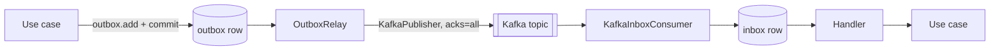

# Messaging architecture

Domain events travel through Kafka using the transactional outbox and an idempotent inbox. The
code is `libs/py/sb_messaging`, on top of the platform tables from [data](data.md). Rules: A11
(events go through the outbox), A13, C6 (bounded I/O), T5 (real infra).

## Topics and the envelope

The topic is `<event_type>.v<schema_version>`, e.g. `ledger.journal_entry.posted.v1`. The JSON
Schema contract for the payload is `contracts/events/<topic>.json`. `make up infra` creates one
topic per file (kafka-init, 3 partitions locally). Auto-creation is off.

`EventEnvelope` is the message on the wire:

| Field | Meaning |
|---|---|
| `event_id` | Unique id. The inbox dedupes on it |
| `event_type`, `schema_version` | What happened, and the payload version |
| `topic` | **Validated**: must equal `<event_type>.v<schema_version>` |
| `key` | Partition key. Same key, same partition, ordered |
| `occurred_at` | Timezone-aware time of the event |
| `tenant_id`, `actor`, `request_id`, `trace_id` | The context that raised the event |
| `payload` | The `DomainEvent` as JSON |

`actor` and `request_id` follow the same charset and length rules as HTTP (`sb_http.auth`): actor
1-128 chars of `[A-Za-z0-9._:@-]`, request id 1-128 chars of `[A-Za-z0-9._:-]`. A value outside
them fails to parse, so the message is poison (see the consumer failure policy). On the producer
side, an outbox row with such a value cannot become an envelope, so the relay treats it as a
poison row: keep actors inside the HTTP rules.

Readers ignore unknown top-level fields (tolerant reader), so a producer can add one. Never forward
`to_bytes()` of a decoded envelope, as that drops fields this version does not know. Forward the
original bytes.

## Flow



1. The use case adds the event and commits. The event is a row in the same transaction as the
   business change, so both happen or neither does.
2. `OutboxRelay.run_once()` selects unpublished rows in id order, publishes each, and marks it
   `published_at`. It works across tenants, with a plain session.
3. `KafkaInboxConsumer` polls, decodes the envelope and calls `process`. That runs the handler as
   the envelope's tenant and actor, in a unit of work, after inserting `(consumer, event_id)` into
   `inbox`. Business writes and the inbox row commit together. Only after that commit is the Kafka
   offset committed.

### Handlers call a use case through `joined(uow)`

`process()` opens the unit of work, and a use case normally opens its own (`async with
self._uow() as uow`). To make the use case run **inside** the inbox transaction, the handler
passes it `sb_db.uow.joined(uow)` as its factory:

```python
async def handle_entry_posted(envelope: EventEnvelope, uow: LedgerUnitOfWork) -> None:
    command = ProjectEntry.model_validate(envelope.payload)
    await ProjectEntryUseCase(joined(uow), clock)(command)
```

Inside the joined view, `commit()` and `rollback()` are no-ops. `process()` makes the one real
commit, so the business rows, audit events, outbox rows and the inbox row commit together. If the
use case or the handler raises, the exception propagates and nothing persists, inbox row
included, so the redelivery applies the effect exactly once. A joined use case that must abort
has to raise, because its `rollback()` does nothing. The use case accepts `joined(...)` when it
types its factory as `Callable[[], AbstractAsyncContextManager[TheUnitOfWork]]`.

## Delivery guarantees

Publishing is **at least once**: a crash after a publish but before the relay's commit re-sends the
row. Consuming is **idempotent**: a duplicate finds its inbox row and is skipped. Together the
effects happen effectively once. `KafkaPublisher` uses `enable.idempotence` and `acks=all`, with
timeouts on delivery and on each request (C6).

### Relay behaviour

- **Single active.** Each run takes a transaction-level advisory lock and returns 0 without it. So
  replicas are safe, and only one publishes at a time.
- **A failure stops the batch.** `PublishFailed` or an unpublishable (poison) row ends the run.
  Rows already published in that run stay marked, and the next run starts at the failed row.
  `outbox.publish_failed` logs the `outbox_id`, `event_id`, `topic` and `fatal`.
- **A fatal `PublishFailed` is re-raised** from `run_once()`, after the marks made so far are
  committed. Non-fatal failures just return the count.
- **A poison outbox row blocks the relay** until someone fixes or removes it. Parking such rows
  (a `failed_at` or `last_error` column) is a follow-up.
- Row locks are held for the batch, bounded by `batch_size` times the per-message timeout.

### Ordering

Kafka orders per partition, so per-key order holds only if the outbox ids of one key are assigned
in commit order. That needs **a single writer per key**, or commit-ordered ids. Concurrent
transactions writing the same key can commit out of id order, and the relay publishes by id.
Design so that one process handles a given key at a time (for example a workflow per entity).

### Producer failures

`PublishFailed.fatal` means the producer instance is unusable (for example fenced). The relay logs
it, commits the marks it has made, and re-raises it. It does not rebuild the producer. **A fatal
producer needs a supervisor restart**: let the exception end the process and restart it.

### Consumer failure policy

- A handler error is logged and re-raised, with no offset commit, so the message is redelivered
  after the supervisor restarts the consumer.
- Undecodable bytes go to the `on_poison` hook. The default re-raises. Returning `"skip"` commits
  past the message. A dead-letter topic is a follow-up.
- A failed offset commit is logged and the loop continues. The inbox makes the redelivery harmless.
- Shutdown: set the `stop` event. The message in hand finishes, then the consumer closes.
  `close()` is bounded by `close_timeout` (default 10 s). If it hangs, `kafka.close_timed_out`
  is logged and `run()` returns anyway.

## Trust boundary

Kafka is trusted, authenticated infrastructure: in production only our services can produce to
our topics (ACLs, mTLS). The tenant and actor in an envelope are therefore trusted **because of
that**, and `process()` runs the handler as them. The envelope still validates `actor` and
`request_id` (charset and length), so a malformed message is poison rather than a log-injection
or audit vector. Never expose a topic to a producer outside that boundary.

## Testing

Integration tests use a real Kafka broker and Postgres through testcontainers (`sb_testing`), and
need no `make up`. Every consumer needs a duplicate-delivery test: deliver the same message twice
and assert the effect happened once. Unit tests use `RecordingPublisher` and fakes, not mocks (T3).
See the [`kafka-event`](../../.claude/skills/kafka-event/SKILL.md) skill.
