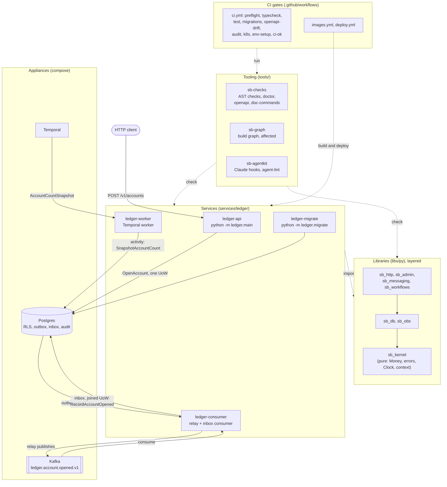

# Architecture overview

How the pieces fit together. Read this after [`environment_setup.md`](../environment_setup.md);
the detail lives in the linked docs.

## The ledger is a thin slice

The only service, [`ledger`](../../services/ledger/CLAUDE.md), exists to prove that every seam of the
scaffolding works end to end, not to model a ledger. It has accounts, a per-tenant count of
accounts, and dated snapshots of that count. It deliberately does **not** model:

- double-entry bookkeeping: journal entries, postings, balances, reversals and the deferred
  balance trigger (spec section 6);
- the end-of-day balance snapshot and per-tenant schedules (the workflow has no schedule);
- the `LegalEntity` registry, which is deferred to a future `entities` service (the ledger holds
  only a `tenant_id`).

Copy its shape, not its domain. The words it uses are in
[`services/ledger/CONTEXT.md`](../../services/ledger/CONTEXT.md) and the context map is
[`CONTEXT-MAP.md`](../CONTEXT-MAP.md).

## Diagram

## Request flow

1. `POST /v1/accounts` with `X-Tenant-Id` and an `Idempotency-Key` reaches the thin route in
   `interface/http`, which only calls the `OpenAccount` use case (A8).
2. `OpenAccount` runs in one unit of work on Postgres, as the `sb_app` role, so row-level security
   scopes everything to the tenant (A13). In that one transaction it writes the account, an audit
   event (A14), the idempotency record, and an `AccountOpened` row in the outbox (A11).
3. The relay loop in `ledger-consumer` reads unsent outbox rows and publishes them to the
   `ledger.account.opened.v1` topic. If publishing fails fatally the process exits and the
   supervisor restarts it.
4. The same process consumes the topic. Each message goes through the inbox (a duplicate is
   skipped). The handler in `interface/consumers/account_opened.py` calls `RecordAccountOpened`
   with `sb_db.uow.joined(uow)`, so the count change, its audit event and the inbox row commit
   atomically or not at all.
5. A replayed `Idempotency-Key` returns the stored account (200); the same key with a different
   body is a 422; a racing duplicate is a 409.

## Workflow flow

The `AccountCountSnapshot` workflow (deterministic, `interface/workflows`) runs on the Temporal
server. Its activity calls the `SnapshotAccountCount` use case with the workflow id as the
idempotency key, so a Temporal retry writes one audit event, not two. The thin slice has no
schedule: tests start the workflow.

## Components and their docs

| Component | What it is | Doc |
|---|---|---|
| `ledger-api`, `ledger-worker`, `ledger-consumer`, `ledger-migrate` | The ledger service's four processes | [ledger notes](../../services/ledger/CLAUDE.md), [glossary](../../services/ledger/CONTEXT.md) |
| Ledger layers (domain, application, infrastructure, interface) | Clean layers, business rules only in use cases and policies | [clean architecture](clean-architecture.md) |
| `sb_kernel` | Pure core types: `Money`, errors, `Clock`, request context, events | [clean architecture](clean-architecture.md), [module index](../generated/module-index.md) |
| `sb_db` | Engine, platform tables, RLS, tenant unit of work, audit chain | [data](data.md) |
| `sb_http` | App factory, error mapping, auth context, health, idempotency | [clean architecture](clean-architecture.md), [module index](../generated/module-index.md) |
| `sb_admin` | SQLAdmin setup, dev auth, acceptors | [admin](admin.md) |
| `sb_messaging` | Event envelope, Kafka publisher, outbox relay, inbox consumer | [messaging](messaging.md) |
| `sb_workflows` | Temporal client, worker builder, workflow ids, test environment | [workflows](workflows.md) |
| `sb_obs` | Structured logging and redaction | [module index](../generated/module-index.md) |
| `sb_testing` | Pytest plugin: testcontainers Postgres and Kafka, `FakeClock`, Hypothesis strategies | [testing conventions](../conventions/testing.md) |
| Postgres, Kafka, Temporal | Local appliances, and the production dependencies | [environment setup](../environment_setup.md), [data](data.md), [messaging](messaging.md), [workflows](workflows.md) |
| `sb-checks` | AST convention checks, `doctor`, `openapi`, `doc-commands` | [monorepo](monorepo.md), [architecture conventions](../conventions/architecture.md) |
| `sb-graph` | Build graph, module index, affected members | [monorepo](monorepo.md), [build graph](../generated/build-graph.md) |
| `sb-agentkit` | Claude hooks, agent-doc lint, guardrail diff | [agent scaffolding](../agents/README.md), [hooks](../agents/hooks.md) |
| CI gates (`ci.yml`, `claude-review.yml`, `nightly.yml`) | What must pass before merge | [review gates](../agents/review-gates.md), [monorepo](monorepo.md) |
| `images.yml`, `deploy.yml`, `deploy/k8s` | Image build, gated deploy, manifests | [deployment](deployment.md) |
| Event and API contracts | `contracts/events/*.json`, `contracts/openapi/*.json` | [messaging](messaging.md) |

The import rules that keep these layers honest (A1, A2, A9) are enforced by tach and
import-linter; see [monorepo](monorepo.md) and [ADR 0003](../adr/0003-boundary-enforcement.md).
